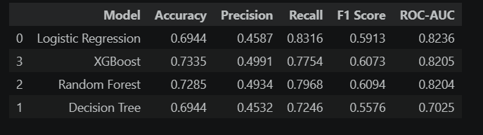
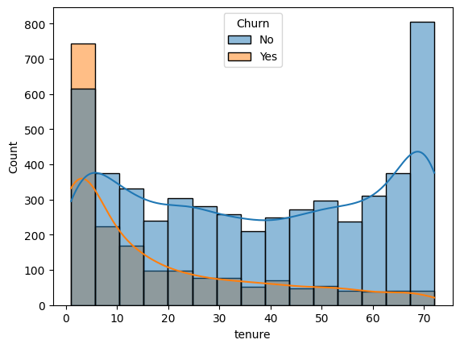
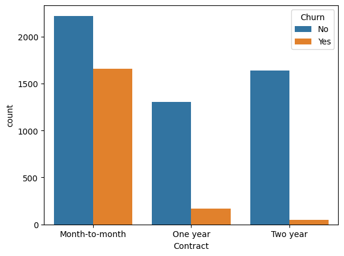
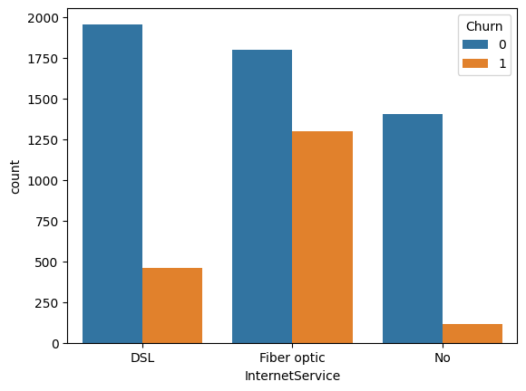
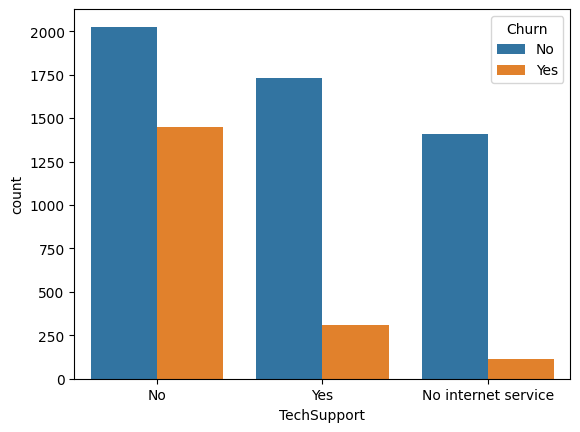
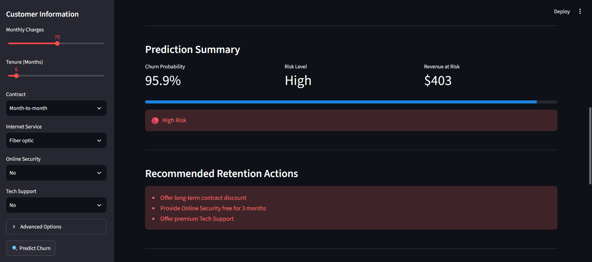
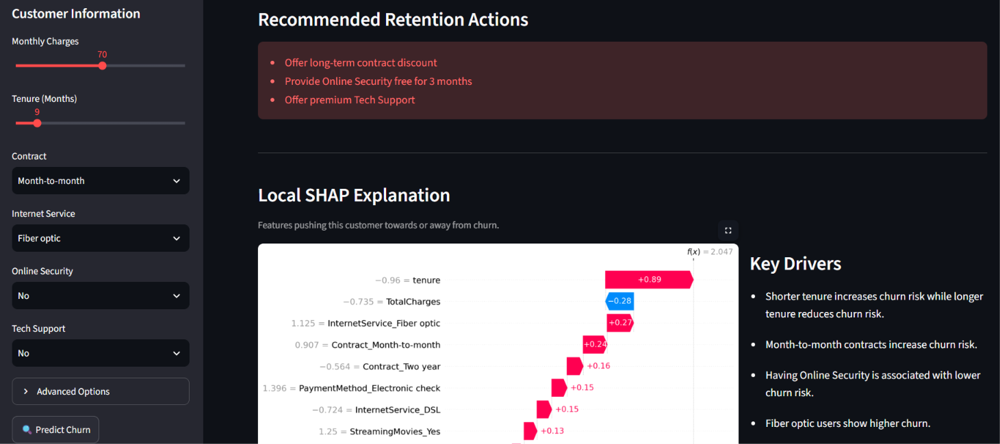
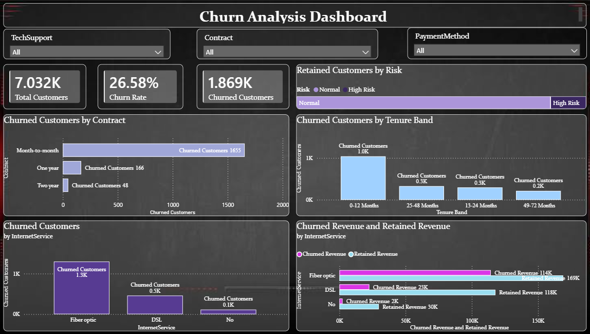

# Customer Churn Prediction using Machine Learning

## Project Overview

Customer churn is one of the biggest challenges for subscription-based businesses. This project predicts whether a customer is likely to leave the company and explains each prediction using SHAP (Explainable AI). A Power BI dashboard provides business insights, while a Streamlit web application enables interactive predictions.

---

## Business Problem

Retaining existing customers is significantly more cost-effective than acquiring new ones. This project helps businesses:

- Predict customers at risk of churn
- Understand the factors driving churn
- Support data-driven customer retention strategies

---
## Project Structure

```text
customer-churn-prediction/
│
├── app
│
├── assets
│
├── data
│
├── images
│
├── models
│
├── notebooks
│
└── README.md
```
---

## Dataset

- **Source:** Telco Customer Churn Dataset from Kaggle (https://www.kaggle.com/datasets/blastchar/telco-customer-churn)

---

## Installations


### Clone the repository

```bash
git clone https://github.com/gravionic/customer-churn-prediction.git
cd customer-churn-prediction
```

### Technologies

`Python` `Pandas` `NumPy` `Scikit-learn` `Streamlit` `Matplotlib` `Joblib` `imbalanced-learn` `shap`

```bash
pip install -r requirements.txt
```

---

## Machine Learning Pipeline

- Data Cleaning
- Feature Engineering
- One-Hot Encoding
- Feature Scaling
- Model Training
- Hyperparameter Tuning
- Model Evaluation
- SHAP Explainability
- Model Deployment using Streamlit

---

## Models Evaluated

- Logistic Regression
- Decision Tree
- Random Forest
- XGBoost


---
## Model Selection


| Metric | Logistic Regression | XGBoost
|---------|-------------|--------------:|
| Accuracy | 73.13% |77.54% |
| Precision | 49.66% |56.56% |
| Recall | 77.54% |66.84% |
| F1 Score | 60.54% |60.54% |
| ROC-AUC | 0.8328 |0.8331 |

Although XGBoost achieved the highest ROC-AUC (0.8331), Logistic Regression achieved substantially higher recall (0.7754) while maintaining an almost identical ROC-AUC (0.8328). Since the primary business objective is to identify customers who are likely to churn, Recall is particularly important. But Recall alone could lead to excessive false positives.Therefore, Logistic Regression and XGBoost were both selected for further evaluation and their predicted probabilities were calibrated to improve probability reliability.


---

### Final Calibrated Model

The selected models were calibrated using sigmoid calibration to improve the reliability of their predicted churn probabilities.

| Metric (calibrated, 30% threshold) | Logistic Regression | XGBoost |
|---|---|---|
| ROC-AUC | 0.8328 | 0.8331 |
| Brier score | 0.1410 | 0.1422 |
| Mean predicted churn (actual 26.58%) | 27.16% | 27.64% |
| Precision | 0.51 | 0.54 |
| Recall | 0.76 | 0.72 |
| F1 score | 0.61 | 0.62 |
| Accuracy | 0.74 | 0.76 |

XGBoost achieved higher accuracy, precision, and F1-score, while Logistic Regression achieved higher churn recall (approximately 76% vs 72%). Logistic Regression also produced a slightly lower Brier score (0.1410 vs 0.1422) indicating marginally better probabilistic performance. XGBoost leads on precision, F1 and accuracy while Logistic Regression leads on recall and Brier score. But since the primary objective of this project is to identify potential churners and minimize missed churn cases and Logistic Regression along with highest recall, also provides a simpler interpretation and a simpler deployment, **Logistic Regression was selected as the final model**.

(The 30% probability threshold is treated as a business-oriented operating point, not a formally cost-optimized threshold. The choice reflects the assumption that missing a potential churner may be more costly than contacting a customer who ultimately does not churn.)

---

## Key Findings

The SHAP analysis identified the strongest drivers of customer churn:

- Short customer tenure
- Month-to-month contracts
- No Online Security
- Fiber optic internet service
- No Tech Support

Customers with longer contracts, longer tenure, and additional security services were considerably less likely to churn.

## Supporting Visualizations









---

## Streamlit Web Application

The application allows users to:

- Enter customer information
- Predict churn probability
- View customer risk level
- Get retention recommendations
- Understand predictions through SHAP Explainable AI



---

## Power BI Dashboard

The dashboard provides business insights including:

- Customer distribution
- Churn rate
- Revenue analysis
- Contract type analysis
- Payment method analysis
- Customer demographics
- Churn by tenure



---

## Future Improvements

- Add LLM-based retention recommendations
- Integrate customer database support
- Add batch prediction functionality

---

## Author

Mohit